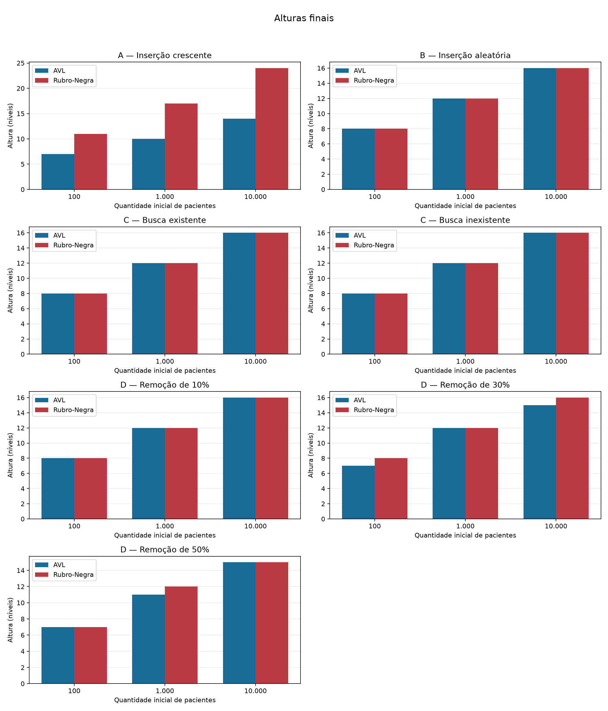
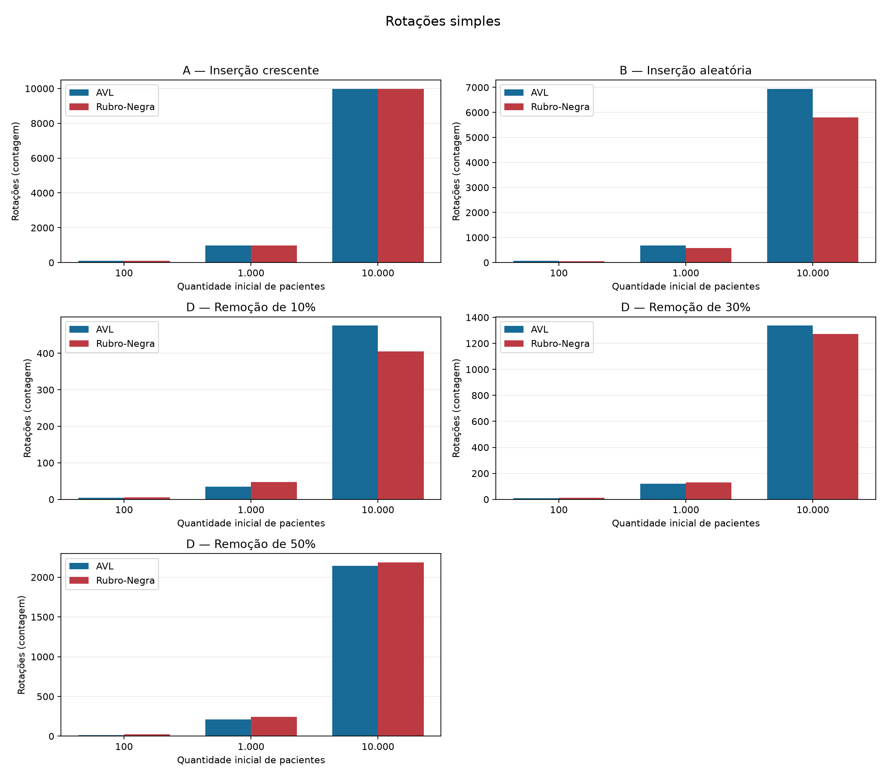
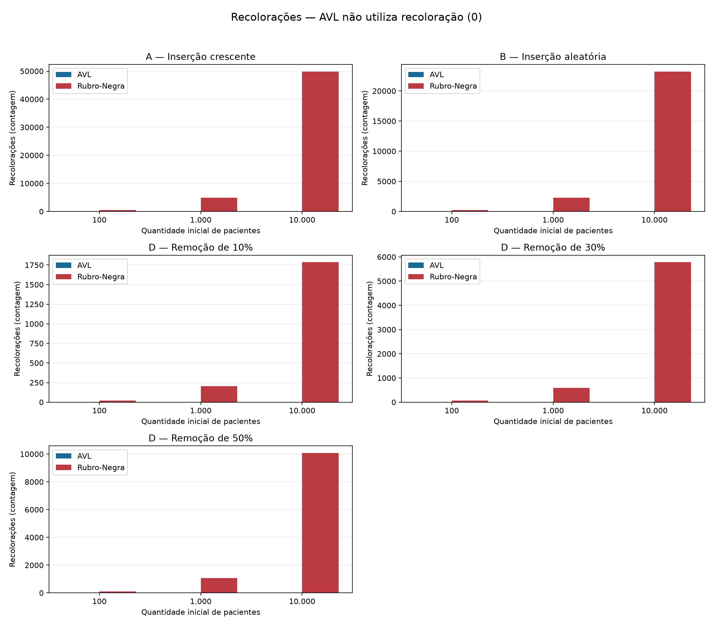
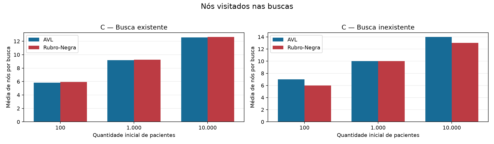
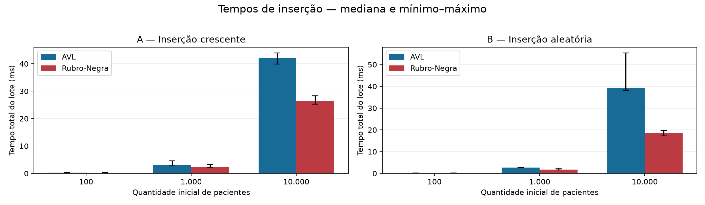
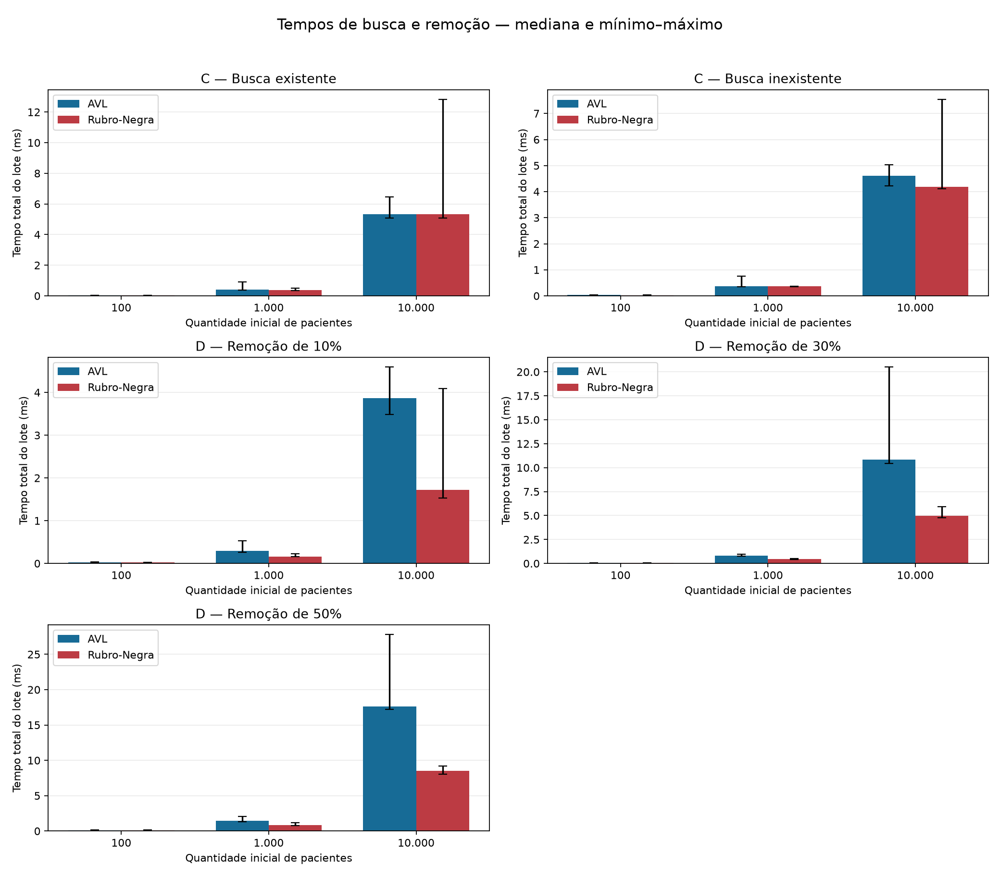

# Metodologia e resultados — Clínica / Atendimento

## 9.1 Objetivo dos experimentos

Comparar as implementações AVL e Rubro-Negra do Trabalho Prático I de AED II
no cadastro, consulta e remoção de pacientes fictícios de uma clínica. A
comparação considera estrutura, trabalho de balanceamento, caminhos de busca
e tempos observados, mantendo as entradas e as sequências de operações
equivalentes. Os resultados caracterizam estas implementações neste ambiente.

## 9.2 Modelagem dos pacientes

`Paciente` é uma dataclass imutável com quatro atributos: número do prontuário
inteiro positivo, nome textual não vazio, data de nascimento real em formato
`AAAA-MM-DD` e telefone textual obrigatório. O prontuário identifica o registro
e constitui a chave de ordenação nas duas árvores. A aplicação rejeita chaves
duplicadas; os demais campos não alteram a ordem das estruturas.

O telefone não pode ser vazio ou conter somente caracteres de espaçamento,
incluindo tabulações e quebras de linha. Sua representação original é
preservada, inclusive zeros iniciais e espaços em um telefone não vazio.
Não se aplica conversão para inteiro nem validação adicional de formato.

## 9.3 Geração dos conjuntos

`gerar_dados.py` produz registros sintéticos, com nomes identificados como
“Fictício”, datas entre 1940-01-01 e 2020-12-31 e telefones iniciados por `00`.
Cada conjunto contém prontuários consecutivos únicos de 1 até seu tamanho.
Foram utilizados 100, 1.000 e 10.000 pacientes e a semente inteira 42.

O gerador utiliza uma instância local de `random.Random(seed)`, sem modificar
o estado aleatório global. `preparar_cenarios()` prepara a ordem crescente e
uma cópia embaralhada com a mesma semente. AVL e Rubro-Negra recebem os mesmos
objetos `Paciente`, na mesma ordem dentro de cada cenário. A reprodução exige
preservar código, parâmetros e versão do Python; os hashes e a versão foram
registrados no manifesto da coleta.

## 9.4 Metodologia experimental

**A — Inserção crescente.** Cada árvore começa vazia e recebe todos os pacientes
em ordem crescente de prontuário. A altura inicial é zero; a final é medida
após o lote completo. Registram-se quantidade, tempo, rotações, recolorações e
validação estrutural.

**B — Inserção aleatória.** O mesmo conjunto é inserido na sequência embaralhada
reproduzível. Novas instâncias vazias impedem aproveitar o estado de A. Medem-se
os mesmos campos de A.

**C — Busca.** Cada árvore é construída com a sequência de B, fora do cronômetro.
Um lote consulta todos os prontuários existentes, na ordem embaralhada; outro
consulta igual quantidade de prontuários inexistentes, em ordem crescente,
de `maior_prontuario + 1` até `maior_prontuario + quantidade`. Os dois casos
são registrados separadamente. As estruturas podem ser reutilizadas entre
esses dois lotes de consulta, pois as buscas não modificam os pacientes nem
a forma da árvore. Alturas e quantidades são verificadas antes/depois.

**D — Remoção.** Para cada percentual de 10%, 30% e 50%, ambas as estruturas
são reconstruídas com todos os pacientes na ordem de B. Remove-se um prefixo
da sequência embaralhada de prontuários, de comprimento
`quantidade * percentual // 100`. Assim, os percentuais não acumulam remoções.
Registram-se alturas antes/depois, operações, quantidade restante, tempo,
rotações, recolorações e validação. Para 10.000 pacientes, os cenários removem
1.000, 3.000 e 5.000 registros, restando 9.000, 7.000 e 5.000, respectivamente.

A comparação usa instâncias independentes e modo detalhado desativado.
Geração de registros, sequências de operações, semente, método de medição e
verificações são iguais para as duas árvores. A ordem de execução é fixa:
AVL antes da Rubro-Negra em cada cenário.

## 9.5 Coleta das métricas

O cronômetro `time.perf_counter()` mede o tempo total do lote de chamadas,
incluindo o laço Python e a construção da lista de retornos. O CSV conserva
segundos sem arredondamento adicional; tabelas e figuras apresentam
milissegundos. Não se trata de tempo individual por operação.

Ficam fora do intervalo cronometrado: geração e embaralhamento dos dados,
construção prévia para C/D, leitura das alturas inicial/final, reinício e
leitura de estatísticas, comparação dos retornos, validação, caminhamento de
conferência da coleção, impressão, coleta de metadados e gravação dos CSVs.
O tempo inclui a instrumentação executada internamente pelas operações das
próprias árvores. Não há impressão no lote cronometrado.

As alturas seguem a convenção existente: árvore vazia com altura 0 e folha
com altura 1. A altura inicial é lida imediatamente antes da primeira chamada
do cronômetro; a final é obtida após as operações, fora do intervalo medido.
Em C, a coleta suplementar de visitas também não altera a estrutura.

Os contadores são reiniciados antes de cada lote quando o método está
disponível. Diferenças entre leituras anteriores e posteriores isolam as
operações mesmo em implementações sem reinício. A/B utilizam os contadores
com sufixo `_insercao`, e D, com `_remocao`. Uma rotação dupla corresponde a
duas rotações simples. AVL registra zero recolorações, pois não usa cores.
Rubro-Negra contabiliza mudanças efetivas de cor de nós reais, incluindo
a raiz e excluindo NIL, conforme a instrumentação existente.

Nas buscas, uma primeira passagem é cronometrada. Uma segunda passagem, fora
do cronômetro, repete as mesmas chaves e lê `nos_visitados_ultima_busca`
imediatamente após cada chamada. A média é a soma dessas leituras dividida
pelo número de buscas. O nó encontrado é contado; filhos ausentes e NIL não
são contados. Essa segunda passagem não aumenta `operacoes` nem o tempo do CSV.

Após cada lote, os retornos, a quantidade e todos os campos dos pacientes em
ordem são conferidos, além das invariantes estruturais de cada implementação.
Qualquer incompatibilidade interrompe o experimento. Campos ausentes ou não
aplicáveis são `None`, exportados vazios e apresentados como “—” nas tabelas;
zeros disponíveis são conservados. Em C, rotações e recolorações ficam vazias;
em A/B/D, a média de visitas fica vazia.

## 9.6 Repetições

A coleta pequena de conferência usou 10 pacientes e uma execução, com 14 linhas
e todas as métricas aplicáveis verificadas. Seus arquivos estão em
[`resultados/validacao/lote_20261024_144957_e50d0a11`](../resultados/validacao/lote_20261024_144957_e50d0a11/ambiente.json)
e não participam da estatística final.

Foram realizadas cinco execuções completas e sequenciais dos tamanhos 100,
1.000 e 10.000, todas com semente 42. As instâncias são novas entre execuções;
o processo Python é o mesmo. Cada tamanho produz duas linhas de A, duas de B,
quatro de C e seis de D: 14 linhas por tamanho, 42 por execução e 210 no lote.

| Execução | CSV, relativo à pasta do lote | Linhas | Situação |
| --- | --- | --- | --- |
| 01 | `execucao_01.csv` | 42 | Concluída |
| 02 | `execucao_02.csv` | 42 | Concluída |
| 03 | `execucao_03.csv` | 42 | Concluída |
| 04 | `execucao_04.csv` | 42 | Concluída |
| 05 | `execucao_05.csv` | 42 | Concluída |

A pasta do lote é
[`resultados/execucoes/lote_20261024_145003_136938db`](../resultados/execucoes/lote_20261024_145003_136938db/ambiente.json).
O manifesto associa identificadores, arquivos, horários e hashes SHA-256.
Os arquivos individuais preservam as medições reais e seus bytes originais,
incluindo as terminações CRLF dos CSVs gerados no Windows, para que os hashes
continuem verificáveis após o versionamento. O CSV histórico
[`resultados/resultados.csv`](../resultados/resultados.csv) permanece intacto,
sem altura inicial retroativa, e não participa desta análise.

Para cada combinação de tamanho, cenário e árvore, a análise usa os cinco
tempos. Calculam-se mediana, mínimo, máximo e amplitude absoluta
`máximo − mínimo`. A mediana reduz a influência de observações extremas, e
os extremos explicitam a variabilidade observada. Não se descartaram tempos
extremos e não se substituíram métricas ausentes por zeros. As métricas
estruturais devem coincidir entre repetições; a análise interrompe diante de
divergências, sem ocultá-las com médias.

## 9.7 Ambiente experimental

Informações obtidas programaticamente por `platform`, `sys`, `datetime`,
`time.get_clock_info()` e Git, disponíveis integralmente em
[`ambiente.json`](../resultados/execucoes/lote_20261024_145003_136938db/ambiente.json):

| Informação | Valor observado |
| --- | --- |
| Python completo | `3.15.0 (tags/v3.15.0:d220409, Oct 9 2026, 11:55:56) [MSC v.1951 64 bit (AMD64)]` |
| Sistema | Windows 11, `Windows-11-10.0.26200-SP0` |
| Versão do sistema | `10.0.26200` |
| Arquitetura | `64bit`, máquina `AMD64` |
| Processador, descrição disponível | `Intel64 Family 6 Model 183 Stepping 1, GenuineIntel` |
| Nome comercial do processador | Não pôde ser identificado pelo procedimento utilizado |
| Início da coleta | 24/10/2026, 14:50:03.888263, UTC−04:00 |
| Fim da coleta | 24/10/2026, 14:50:08.137253, UTC−04:00 |
| Fuso dos registros | America/Manaus |
| Cronômetro | `QueryPerformanceCounter()`, monotônico |
| Resolução informada | `0,0000001 s` (100 ns), sem equivalência com precisão garantida |
| Semente | 42 |
| Tamanhos | 100, 1.000 e 10.000 |
| Repetições | 5 |
| Commit do código medido | `138a4bfc89fcace472dc6f31dd4f10403524a67b` |
| Branch | `feature/finalizacao-sistema-experimentos` |
| Matplotlib da análise | 3.11.2, utilizado após a coleta |

No início da coleta definitiva, o estado Git registrava somente a pasta da
coleta pequena ainda não versionada (`?? resultados/validacao/`); os fontes
medidos já estavam em commits. O manifesto registra hashes dos sete arquivos
envolvidos na coleta. A análise também registra seu próprio hash em
[`verificacao.json`](../resultados/tabelas/lote_20261024_145003_136938db/verificacao.json).
Commits posteriores versionam resultados e documentação.

Procedimento para uma nova coleta, a partir da raiz:

```console
python -m unittest discover -s tests -v
python coleta_experimentos.py --tamanhos 10 --seed 42 --repeticoes 1 --destino resultados/validacao
python coleta_experimentos.py --tamanhos 100 1000 10000 --seed 42 --repeticoes 5
python analise_experimentos.py CAMINHO_DO_NOVO_LOTE
```

Os lotes recebem identificadores únicos; arquivos anteriores não são
sobrescritos. Para reproduzir as tabelas e figuras desta coleta sem executar
novamente as árvores:

```console
python analise_experimentos.py resultados/execucoes/lote_20261024_145003_136938db --saida resultados/reanalise_01
```

Instalação opcional dos gráficos: `python -m pip install matplotlib==3.11.2`,
preferencialmente em ambiente virtual. No ambiente desta sessão, a biblioteca
foi isolada em `.venv/plotdeps`, adicionada ao `PYTHONPATH` somente nos comandos
de análise e testes de PNG; o cache foi direcionado a `.venv/mplconfig`.
O sistema e a coleta não importam matplotlib. `--sem-graficos` permite gerar
as tabelas somente com a biblioteca padrão.

## 9.8 Resultados

As cinco execuções completaram as 210 linhas previstas. Todas apresentaram
`valido=True`, sem limitações de instrumentação. As métricas estruturais dos
42 grupos foram idênticas entre repetições, sem divergências a investigar.
Os 60 campos vazios de rotações e de recolorações pertencem às linhas de C;
os 150 campos vazios de visitas pertencem a A/B/D. Esses valores não são
falhas de coleta, mas métricas não aplicáveis, conforme o esquema.

As tabelas completas, com os três tamanhos e todos os cenários, estão em:

- [Resumo CSV com tempos e estrutura](../resultados/tabelas/lote_20261024_145003_136938db/resumo.csv).
- [Tempos: mediana, mínimo, máximo e amplitude](../resultados/tabelas/lote_20261024_145003_136938db/tempos.md).
- [Alturas, quantidades, rotações, recolorações e visitas](../resultados/tabelas/lote_20261024_145003_136938db/estruturas.md).
- [Verificação da integridade e consistência](../resultados/tabelas/lote_20261024_145003_136938db/verificacao.json).

O recorte abaixo apresenta os lotes com 10.000 pacientes. Todos os tempos
estão em **milissegundos** e derivam das cinco repetições, sem exclusões.

| Cenário | Árvore | Mediana | Mínimo | Máximo | Amplitude |
| --- | --- | --- | --- | --- | --- |
| A — Crescente | AVL | 42,1328 | 39,8922 | 43,9122 | 4,0200 |
| A — Crescente | Rubro-Negra | 26,3644 | 25,2481 | 28,3083 | 3,0602 |
| B — Aleatória | AVL | 39,2417 | 38,1260 | 55,2967 | 17,1707 |
| B — Aleatória | Rubro-Negra | 18,6951 | 17,2075 | 19,7670 | 2,5595 |
| C — Existente | AVL | 5,3287 | 5,0689 | 6,4716 | 1,4027 |
| C — Existente | Rubro-Negra | 5,3193 | 5,0920 | 12,8242 | 7,7322 |
| C — Inexistente | AVL | 4,6109 | 4,2212 | 5,0350 | 0,8138 |
| C — Inexistente | Rubro-Negra | 4,1872 | 4,1063 | 7,5398 | 3,4335 |
| D — 10% | AVL | 3,8688 | 3,4863 | 4,5948 | 1,1085 |
| D — 10% | Rubro-Negra | 1,7211 | 1,5287 | 4,0951 | 2,5664 |
| D — 30% | AVL | 10,8166 | 10,4352 | 20,5053 | 10,0701 |
| D — 30% | Rubro-Negra | 4,9784 | 4,7733 | 5,9325 | 1,1592 |
| D — 50% | AVL | 17,6388 | 17,2224 | 27,7859 | 10,5635 |
| D — 50% | Rubro-Negra | 8,5509 | 8,0548 | 9,2206 | 1,1658 |

Nesse recorte, a Rubro-Negra apresentou menores medianas de tempo nos cenários
avaliados. Nas buscas existentes, as medianas foram próximas e os intervalos
observados se sobrepõem; o conjunto não fundamenta uma conclusão de diferença
estatisticamente significativa. A maior observação de B na AVL foi preservada,
produzindo amplitude de 17,1707 ms; não foi identificada uma causa específica.

Na inserção crescente de 10.000 pacientes, a AVL terminou com altura 14,
9.986 rotações e nenhuma recoloração; a Rubro-Negra terminou com altura 24,
9.976 rotações e 49.877 recolorações. Mesmo com maior altura, a Rubro-Negra
apresentou menor mediana nesse cenário. Na inserção aleatória, ambas ficaram
com altura 16; AVL e Rubro-Negra realizaram 6.946 e 5.806 rotações,
respectivamente, e a Rubro-Negra registrou 23.230 recolorações.

Nas buscas existentes do mesmo tamanho, as médias de visitas foram 12,5611
na AVL e 12,6458 na Rubro-Negra. Nas inexistentes, foram 14 e 13. Todas as
alturas de C permaneceram em 16. Nas remoções de 50%, as alturas passaram de
16 para 15 em ambas; foram registradas 2.143 rotações na AVL e 2.187 na
Rubro-Negra, com 10.079 recolorações nesta última. Os exemplos mostram que
altura e quantidade de rotações, isoladamente, não determinam o tempo.

As seis figuras abaixo utilizam exclusivamente as tabelas derivadas dos CSVs.
Os painéis distinguem cenários; as escalas verticais são próprias de cada
painel, partem de zero e informam unidade. Não se devem comparar alturas
visuais de barras entre painéis com limites diferentes. Nas figuras de tempo,
a barra indica mediana e as hastes alcançam mínimo e máximo; não são intervalos
de confiança. As entradas menores podem produzir barras muito baixas na
escala linear; os valores exatos estão nas tabelas.













## 9.9 Limitações

**Padrão de buscas inexistentes.** Todos os prontuários inexistentes são maiores
que o maior cadastrado. Assim, as consultas tendem a percorrer o caminho à
direita da árvore e não constituem uma amostra distribuída de todas as buscas
malsucedidas possíveis. Esse padrão permite comparação controlada entre as
estruturas, mas limita a generalização para chaves abaixo do mínimo ou em
lacunas internas. O padrão original foi preservado e não foi alterado para
modificar os resultados.

**Ambiente e concorrência.** Os tempos dependem do processador, da frequência
efetiva, do sistema operacional, do interpretador e de possíveis processos
concorrentes. Não houve isolamento de núcleo, controle de frequência ou
monitoramento da carga externa. Não se atribuem oscilações observadas a uma
causa de hardware sem evidência. O identificador de processador disponível
não fornece seu nome comercial.

**Cronômetro e procedimento.** A resolução informada do cronômetro não elimina
variabilidade nem garante precisão equivalente. Não foi subtraído o custo do
laço e da lista de retornos. As operações mantêm sua instrumentação interna;
a coleta de lixo segue o padrão do Python. A ordem AVL/Rubro-Negra é fixa e
não houve fase dedicada de aquecimento ou reinício do processo entre
repetições. Caches e atividades anteriores, inclusive as validações fora do
cronômetro, podem influenciar a execução subsequente.

**Amostragem.** Uma única semente mantém as entradas comparáveis, mas cobre
apenas uma ordem aleatória por tamanho. Cinco repetições caracterizam uma
variabilidade limitada; não substituem várias sementes, ambientes e cargas
de trabalho. Não foram calculados intervalos de confiança nem testes de
significância. As duas árvores foram medidas no mesmo ambiente; nenhuma
medição histórica ou da coleta pequena foi misturada ao lote definitivo.

**Interpretação.** Resultados empíricos descrevem execuções finitas de códigos
específicos; não constituem demonstração de complexidade assintótica.
Menor altura não implica que uma árvore será sempre mais rápida: custos de
balanceamento, instrumentação, implementação e ambiente também participam.
As conclusões ficam restritas aos cenários, tamanhos e ambiente documentados.

**Restrições da sessão de execução.** A execução inicial da suíte teve quatro
erros de acesso a pastas temporárias do Windows dentro do sandbox. Fora dele,
a suíte final passou com 123 testes, incluindo geração real dos PNGs. A
primeira tentativa de análise no sandbox produziu tabelas, mas falhou ao
carregar integralmente matplotlib. As tabelas parciais e o erro foram
preservados em
[`lote_20261024_145003_136938db_tentativa_sandbox`](../resultados/tabelas/lote_20261024_145003_136938db_tentativa_sandbox/falha.json).
A análise completa foi executada fora do sandbox sobre os mesmos CSVs,
sem refazer tempos, alterar fontes ou modificar medições. Não houve falha
nas cinco execuções experimentais definitivas.
